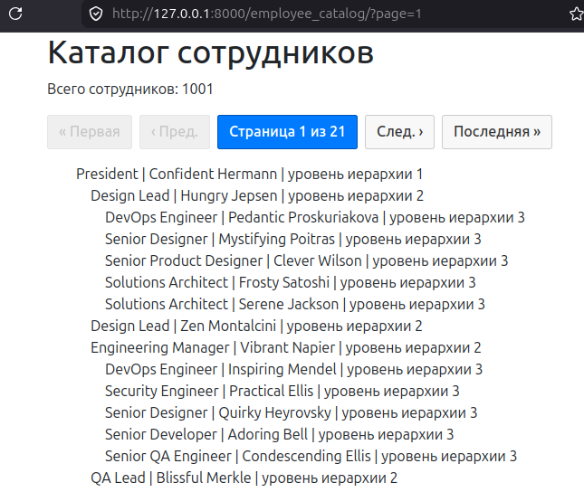
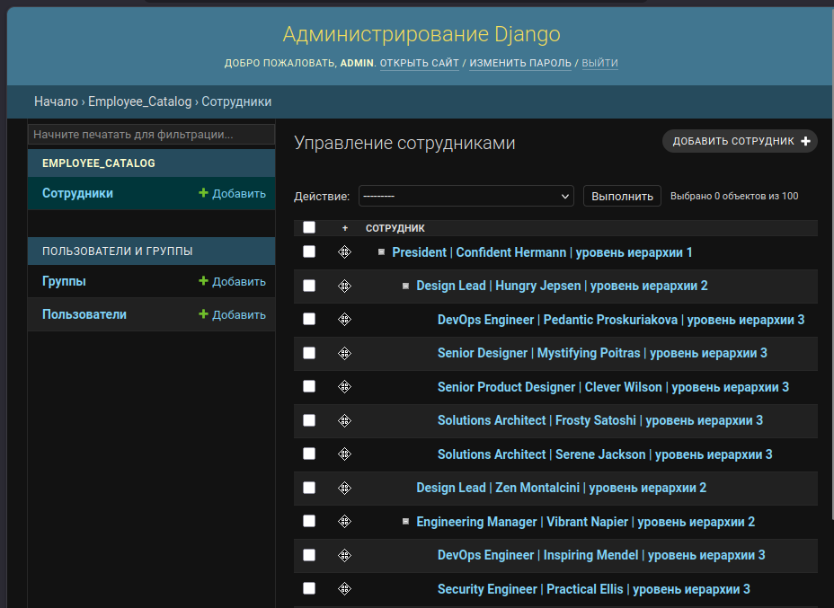
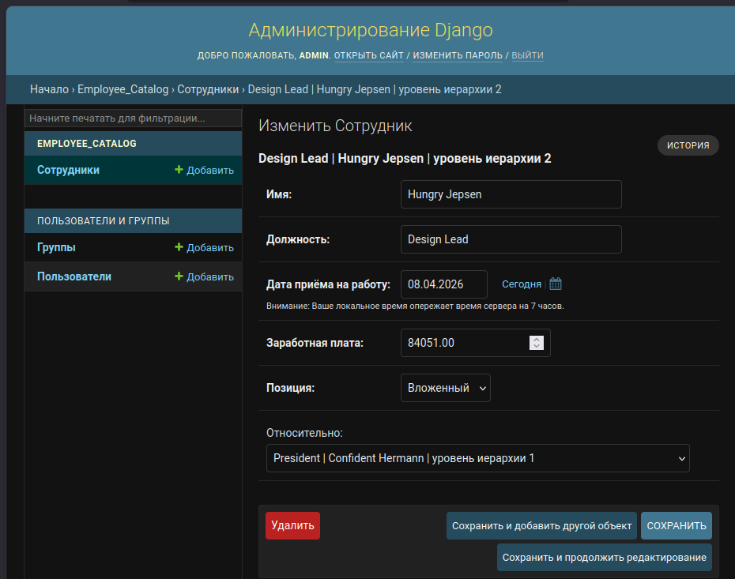

# Online Employees Catalog

A company employee catalog with a hierarchical «manager → subordinates» tree.
The project consists of two applications that share a single database:

- **Django** — catalog web UI, admin, migrations and writes to the tree.
- **FastAPI** — async JSON REST API for reading employees, subtrees and root nodes.

<details>
<summary>Screenshots</summary>







</details>


---

## 1. Quick start

### Requirements

- Python `^3.10` (tested on 3.12)
- [Poetry](https://python-poetry.org/) 2.x
- PostgreSQL **is optional**: SQLite is used by default

### Install

Run from the repository root:

```bash
poetry install
cp .env_example .env
```

`.env` is configured for SQLite (`USE_SQLITE=True`); for PostgreSQL fill in the `DB_*` variables and set `USE_SQLITE=False`.

### Django (web UI)

All Django commands run from the `online_employees_catalog/` directory — the SQLite path is relative to the working directory, so running from the root creates an empty database and the API returns `500`.

```bash
cd online_employees_catalog
poetry run python manage.py migrate
poetry run python manage.py createsuperuser   # optional, for /admin/
poetry run python manage.py runserver
```

- Catalog: http://127.0.0.1:8000/
- Admin: http://127.0.0.1:8000/admin/

### FastAPI (REST API)

In a separate terminal, also from `online_employees_catalog/`:

```bash
poetry run uvicorn fastapi_api.main:app --reload --port 8001
```

- Swagger UI: http://127.0.0.1:8001/docs
- Health check: http://127.0.0.1:8001/health

| Method | Path | Description |
|-------|------|----------|
| GET | `/api/v1/employees?skip=0&limit=50` | Paginated employee list |
| GET | `/api/v1/employees/{id}` | Employee profile |
| GET | `/api/v1/employees/{id}/subtree` | Employee subtree |
| GET | `/api/v1/employees/tree/roots` | Root nodes |

> Django and FastAPI are two independent servers on different ports, but they use **the same database**. Django writes to the tree, FastAPI reads from it. Start them from the same directory, otherwise they will end up with different `db.sqlite3` files.

---

## 2. Seeding the database (seed.py, 50,000 employees)

The script generates a random hierarchy with realistic job titles and salaries per level.
Defaults: `--amount 50000`, `--batch-size 10`, `--max-depth 5`, so 50k employees require no arguments.

Apply migrations first, then run from `online_employees_catalog/`:

```bash
poetry run python manage.py migrate
poetry run python seed.py --amount 50000 --batch-size 10 --max-depth 5
```

Parameters:

- `--amount` — number of employees to generate
- `--batch-size` — batch size (one manager is picked per batch)
- `--max-depth` — maximum hierarchy depth

> Generating 50,000 records is slow: each node is inserted individually via `add_child()` (treebeard's materialized path is recalculated on every insert). For development use a smaller value, e.g. `--amount 1000`.

---

## 3. About the project and technologies

### Overview

Employees form a tree: the root node (CEO) → managers → individual contributors. Each employee has a name, role, hire date and salary. The project can:

- show the employee catalog page by page, including the subtree of a given manager;
- serve the same data as an async JSON API;
- generate test data in bulk.

The tree is stored using a **materialized path**: each node holds `path` (e.g. `00010002`), `depth` (root = 1) and `numchild`. Selecting a subtree is therefore `WHERE path LIKE 'path%'`, and the order of children is set by `node_order_by = ['role', 'name']`.

A key constraint: rows in the `employee_catalog_employee` table must only be written through Django/treebeard (`add_root()` / `add_child()`), otherwise `path`/`depth`/`numchild` become inconsistent and the tree breaks. FastAPI works with the same table in read-only mode.

### Stack

| Technology | Role |
|------------|------|
| Django 4.1 | catalog web UI, admin, migrations, tree writes |
| django-treebeard (MP_Node) | employee hierarchy (materialized path) |
| FastAPI | async REST API |
| SQLAlchemy 2.0 (async) | async database access in the API |
| Pydantic v2 | request/response schemas and validation |
| Uvicorn | ASGI server for FastAPI |
| SQLite / PostgreSQL | database: `aiosqlite` for the API, `psycopg2` for Django, `asyncpg` for Postgres |
| python-decouple / python-dotenv | loading settings from `.env` |
| names-generator | name generation in seed.py |
| Poetry | dependency and virtualenv management |

### Structure

```
online_employees_catalog/          # project working root (manage.py, seed.py)
├── manage.py
├── seed.py                        # 50k employee generator
├── online_employees_catalog/      # Django project settings
│   └── settings.py
├── employee_catalog/              # Django app: Employee model, views, urls
└── fastapi_api/                   # FastAPI application
    ├── main.py                    # entry point, registers routers
    ├── config.py                  # settings and DATABASE_URL
    ├── database.py                # async engine and sessions
    ├── models.py                  # SQLAlchemy model of the treebeard table
    ├── crud.py                    # database queries
    ├── schemas.py                 # Pydantic schemas
    └── routers/employees.py       # /api/v1/employees endpoints
tests/                             # tests (pytest)
conftest.py
```

The final API prefixes come from two places: `app.include_router(..., prefix="/api")` in `main.py` plus `APIRouter(prefix="/v1/employees")` in the router → `/api/v1/employees`.

<details>
<summary>Русская версия</summary>

# Online Employees Catalog

Каталог сотрудников компании с иерархической структурой (дерево «руководитель → подчинённые»).
Проект состоит из двух приложений, работающих с одной и той же базой данных:

- **Django** — веб-интерфейс каталога, админка, миграции и запись данных в дерево.
- **FastAPI** — асинхронное REST API (JSON) для чтения сотрудников, поддеревьев и корневых узлов.

---

## 1. Быстрый старт

### Требования

- Python `^3.10` (проверено на 3.12)
- [Poetry](https://python-poetry.org/) 2.x
- PostgreSQL **не обязателен**: по умолчанию используется SQLite

### Установка

Выполнять из корня репозитория:

```bash
poetry install
cp .env_example .env
```

`.env` настроен на SQLite (`USE_SQLITE=True`); для PostgreSQL заполните `DB_*` и выставьте `USE_SQLITE=False`.

### Django (веб-интерфейс)

Все команды Django запускаются из каталога `online_employees_catalog/` — путь к SQLite задан относительно рабочей директории, при запуске из корня создастся пустая БД и API вернёт `500`.

```bash
cd online_employees_catalog
poetry run python manage.py migrate
poetry run python manage.py createsuperuser   # опционально, для /admin/
poetry run python manage.py runserver
```

- Каталог: http://127.0.0.1:8000/
- Админка: http://127.0.0.1:8000/admin/

### FastAPI (REST API)

В отдельном терминале, тоже из `online_employees_catalog/`:

```bash
poetry run uvicorn fastapi_api.main:app --reload --port 8001
```

- Swagger UI: http://127.0.0.1:8001/docs
- Health-check: http://127.0.0.1:8001/health

| Метод | Путь | Описание |
|-------|------|----------|
| GET | `/api/v1/employees?skip=0&limit=50` | Список сотрудников с пагинацией |
| GET | `/api/v1/employees/{id}` | Профиль сотрудника |
| GET | `/api/v1/employees/{id}/subtree` | Поддерево сотрудника |
| GET | `/api/v1/employees/tree/roots` | Корневые узлы |

> Django и FastAPI — это два независимых сервера на разных портах, но **одна и та же БД**. Django пишет в дерево, FastAPI читает. Запускать из одной директории, иначе разойдутся по разным файлам `db.sqlite3`.

---

## 2. Наполнение БД (seed.py, 50 000 сотрудников)

Скрипт генерирует случайную иерархию с реалистичными должностями и зарплатами по уровням.
Дефолты: `--amount 50000`, `--batch-size 10`, `--max-depth 5`, поэтому для 50 тысяч достаточно команды без аргументов.

Сначала обязательно примените миграции, затем из `online_employees_catalog/`:

```bash
poetry run python manage.py migrate
poetry run python seed.py --amount 50000 --batch-size 10 --max-depth 5
```

Параметры:

- `--amount` — сколько сотрудников сгенерировать
- `--batch-size` — размер пакета обработки (выбирается один начальник для пакета)
- `--max-depth` — максимальная глубина иерархии

> Генерация 50 000 записей небыстрая: каждый узел вставляется отдельно через `add_child()` (материализованный путь treebeard пересчитывается на каждой вставке). Для разработки используйте небольшое значение, например `--amount 1000`.

---

## 3. О проекте и технологиях

### Суть

Сотрудники образуют дерево: корневой узел (CEO) → руководители → рядовые специалисты. У каждого сотрудника есть имя, должность, дата приёма и зарплата. Проект умеет:

- показывать каталог сотрудников постранично, включая поддерево конкретного руководителя;
- отдавать те же данные в виде асинхронного JSON API;
- массово генерировать тестовые данные.

Для хранения дерева используется **материализованный путь** (materialized path): в каждом узле хранится `path` (например `00010002`), `depth` (глубина, корень = 1) и `numchild`. Поэтому выборка поддерева — это `WHERE path LIKE 'путь%'`, а порядок детей задаётся полем `node_order_by = ['role', 'name']`.

Ключевое ограничение: записи в таблицу `employee_catalog_employee` должны идти только через Django/treebeard (`add_root()` / `add_child()`), иначе поля `path`/`depth`/`numchild` станут некорректными и дерево сломается. FastAPI работает с этой же таблицей только на чтение.

### Стек

| Технология | Роль |
|------------|------|
| Django 4.1 | веб-каталог, админка, миграции, запись дерева |
| django-treebeard (MP_Node) | иерархия сотрудников (materialized path) |
| FastAPI | асинхронное REST API |
| SQLAlchemy 2.0 (async) | асинхронный доступ к БД в API |
| Pydantic v2 | схемы запросов/ответов и валидация |
| Uvicorn | ASGI-сервер для FastAPI |
| SQLite / PostgreSQL | БД: `aiosqlite` для API, `psycopg2` для Django, `asyncpg` для Postgres |
| python-decouple / python-dotenv | загрузка настроек из `.env` |
| names-generator | генерация имён в seed.py |
| Poetry | управление зависимостями и виртуальным окружением |

### Структура

```
online_employees_catalog/          # рабочий корень проекта (manage.py, seed.py)
├── manage.py
├── seed.py                        # генератор 50k сотрудников
├── online_employees_catalog/      # настройки Django проекта
│   └── settings.py
├── employee_catalog/              # Django-приложение: модель Employee, views, urls
└── fastapi_api/                   # FastAPI-приложение
    ├── main.py                    # точка входа, подключает роутеры
    ├── config.py                  # настройки и DATABASE_URL
    ├── database.py                # async engine и сессии
    ├── models.py                  # SQLAlchemy-модель таблицы treebeard
    ├── crud.py                    # запросы к БД
    ├── schemas.py                 # Pydantic-схемы
    └── routers/employees.py       # эндпоинты /api/v1/employees
tests/                             # тесты (pytest)
conftest.py
```

Итоговые префиксы API собираются из двух мест: `app.include_router(..., prefix="/api")` в `main.py` плюс `APIRouter(prefix="/v1/employees")` в роутере → `/api/v1/employees`.

</details>
